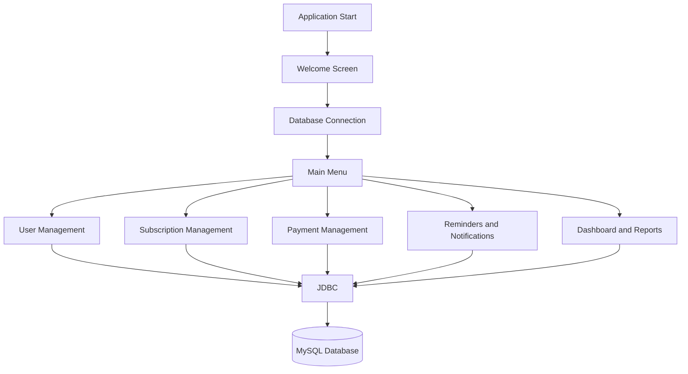

# 💳 Subscription & Recurring Payment Tracker

<p align="center">
  <strong>A Java and MySQL application for managing subscriptions, tracking recurring payments, and monitoring personal expenses.</strong>
</p>

<p align="center">
  
  
  
  
</p>

---

## 📌 Overview

Managing multiple subscriptions and their renewal dates can be challenging. The **Subscription & Recurring Payment Tracker** is a console-based application developed using Core Java, JDBC, and MySQL to organize subscription records, monitor payment activity, and review recurring expenses.

The project demonstrates object-oriented programming, relational database connectivity, SQL operations, input validation, exception handling, and modular application design.

## 📑 Table of Contents

- [✨ Features](#-features)
- [🛠️ Technology Stack](#️-technology-stack)
- [🏗️ Application Workflow](#️-application-workflow)
- [📂 Project Structure](#-project-structure)
- [🗄️ Database Configuration](#️-database-configuration)
- [🚀 Getting Started](#-getting-started)
- [💻 Skills Demonstrated](#-skills-demonstrated)
- [🔮 Future Enhancements](#-future-enhancements)
- [👩‍💻 Author](#-author)

## ✨ Features

<details>
<summary><strong>👤 User Management</strong></summary>

- Manage user records.
- View and maintain user information.
- Perform user-related operations through the console interface.

</details>

<details>
<summary><strong>📅 Subscription Management</strong></summary>

- Add and view subscriptions.
- Manage subscription plans.
- Cancel subscriptions.
- Track subscription-related information.

</details>

<details>
<summary><strong>💰 Payment Management</strong></summary>

- Record and manage payment information.
- Maintain payment methods.
- View payment history.
- Distinguish payment identifiers from subscription identifiers.

</details>

<details>
<summary><strong>🔔 Reminders & Notifications</strong></summary>

- Identify upcoming payment dates.
- Review overdue payments.
- Organize payment-related notification information.

</details>

<details>
<summary><strong>📊 Dashboard & Expense Reports</strong></summary>

- Review subscription and payment information.
- Summarize recurring expenses.
- Access dashboard information.
- Generate expense-related reports.

</details>

## 🛠️ Technology Stack

| Technology | Purpose |
|---|---|
| Java 21 | Core application logic and OOP |
| JDBC | Java-to-MySQL connectivity |
| MySQL | Relational data storage |
| SQL | Database operations and queries |
| Eclipse IDE | Development and debugging |

## 🏗️ Application Workflow



The application uses a modular structure to separate business operations into dedicated Java packages, with JDBC connecting the application to MySQL.

## 📂 Project Structure

```text
Subscription_Recurrent_payment_tracker/
│
├── src/
│   ├── config/
│   │   └── DBConnection.java
│   ├── dashboard/
│   ├── model/
│   ├── notification/
│   ├── payment/
│   ├── reminder/
│   ├── report/
│   ├── subscription/
│   ├── user/
│   ├── utility/
│   └── Subscription_Recurrent_payment_tracker/
│       └── Main.java
│
├── .gitignore
├── .classpath
├── .project
└── README.md
```

## 🗄️ Database Configuration

The application uses MySQL for persistent storage and JDBC for database access.

Before running the application:

1. Install and start MySQL Server.
2. Create the required database.
3. Execute your project's SQL schema and table creation scripts.
4. Configure the JDBC connection settings.
5. Ensure the MySQL JDBC driver is available in the project's build path.

**Security note:** Keep database credentials outside the source code. Never publish real passwords, access tokens, or other secrets in a public repository.

## 🚀 Getting Started

### Prerequisites

- JDK 21 or a compatible JDK.
- MySQL Server.
- MySQL Connector/J.
- Eclipse IDE or another Java IDE.

### Installation

**1. Clone the repository**

```bash
git clone https://github.com/sujithakrishna/subscription-recurring-payment-tracker.git
```

**2. Open the project in Eclipse**

- Select **File → Import**.
- Choose **Existing Projects into Workspace**.
- Select the cloned project directory.
- Finish the import.

**3. Configure the database**

Update the database connection configuration to use your local MySQL database. Execute your existing schema script to create the required tables.

**4. Configure the JDBC driver**

Ensure MySQL Connector/J is included in the project's build path.

**5. Run the application**

Open `Main.java` and select **Run As → Java Application**.

Follow the console menu to access the available operations.

## 💻 Skills Demonstrated

- Core Java and object-oriented programming.
- Java package organization and modular design.
- JDBC database connectivity.
- MySQL and relational database operations.
- CRUD operations.
- Input validation and exception handling.
- Database constraints and data integrity.
- Application debugging using Eclipse.

## 🔮 Future Enhancements

- Graphical user interface.
- Automated email reminders.
- Subscription expense analytics and charts.
- Monthly and yearly expense comparisons.
- Exportable financial reports.
- Payment gateway integration.

## 👩‍💻 Author

**Sujitha V. K.**

- GitHub: [@sujithakrishna](https://github.com/sujithakrishna)
- LinkedIn: [Connect with me](https://www.linkedin.com/in/sujitha-v-k-77a924258/)

---

<p align="center">
  <i>Built to explore practical Java development, database integration, and recurring expense management.</i>
</p>
